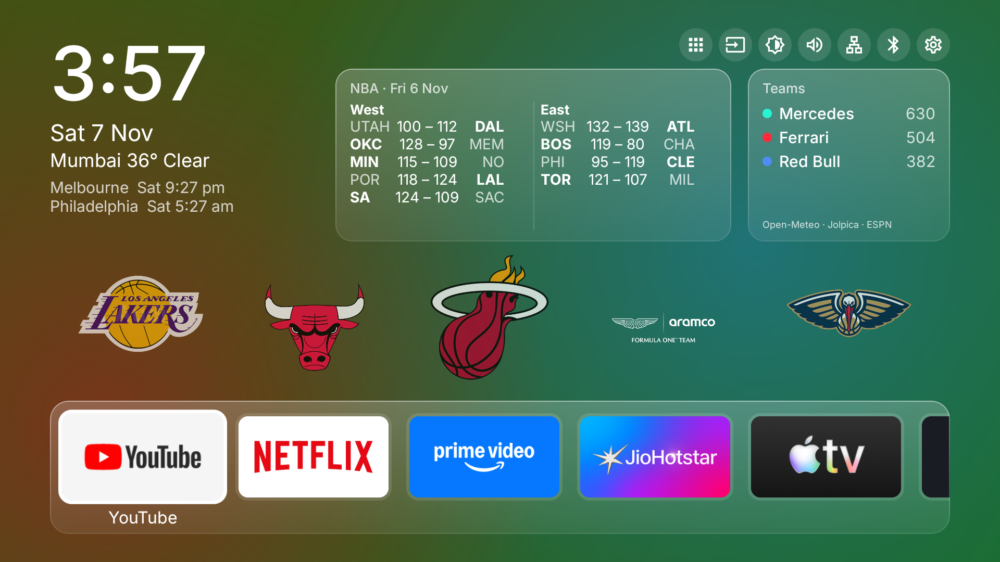

# Bravia Launcher

A custom home screen for Android TV, built for a Sony Bravia (Android TV 10). It replaces the stock Google TV home with a calm, glassy layout: the time and weather, world clocks, live F1 and NBA stats, and a dock of favourite apps. It greets you out loud each time the TV turns on.




## Features

- **Clock and weather.** Large clock, the date and current weather for Mumbai, plus Melbourne and Philadelphia world clocks.
- **NBA scores.** The latest day's results, split into West and East, from ESPN.
- **F1 stats.** A rotating card with constructor and driver standings, the next race, and the latest results and qualifying, from Jolpica.
- **Greeting.** Each time the TV wakes, it shows and speaks a phrase picked for the time of day, like "Good morning" or "Still up?". Weekends get their own.
- **Living background.** A slowly shifting colour hue with faint, shuffling NBA and F1 team logos.
- **Favourites dock.** Hold OK on an app to move it or add and remove it from favourites. An All apps grid holds everything else.
- **Quick actions.** One-press buttons for Inputs, Picture, Sound, Network, Bluetooth and Settings.
- **Built for the remote.** Everything works with the D-pad, inside a 5% safe area for TVs that crop the edges.

Live data refreshes every hour. No accounts or API keys are needed.

## Requirements

- An Android TV running Android 10 (API 29) or newer.
- A Mac or PC with:
  - [Android SDK platform tools](https://developer.android.com/tools/releases/platform-tools) (`adb`)
  - The Android SDK
  - JDK 17

## Setup

### 1. Turn on network debugging on the TV

1. On the TV, open **Settings → Device Preferences → About** and press **Build** seven times to unlock developer options.
2. In **Settings → Device Preferences → Developer options**, turn on **USB debugging** and, if listed, **Network debugging**.
3. Find the TV's IP address in **Settings → Network & Internet**.

### 2. Connect

```bash
adb connect <tv-ip>:5555
```

Accept the debugging prompt on the TV, then check that it's listed:

```bash
adb devices
```

### 3. Build and install

```bash
TV_IP=<tv-ip> ./deploy.sh --open
```

`deploy.sh` builds a release APK, installs it on the TV and, with `--open`, starts it. It expects `adb` in `~/platform-tools`, the SDK in `~/Library/Android/sdk` and a JDK in `~/Library/Java/JavaVirtualMachines`. Edit the top of the script if yours are elsewhere.

The launcher then appears in the TV's apps list as a normal app.

### 4. Make it the home screen (optional)

Android TV doesn't let you pick a different home app in Settings, so you can disable the stock launcher instead. First find its package:

```bash
adb shell cmd package resolve-activity -a android.intent.action.MAIN -c android.intent.category.HOME
```

On most Android TVs it's `com.google.android.tvlauncher`. Disable it:

```bash
adb shell pm disable-user --user 0 com.google.android.tvlauncher
```

Press Home on the remote and this launcher opens instead.

**To undo it**, turn the stock launcher back on:

```bash
adb shell pm enable com.google.android.tvlauncher
```

## Make it yours

| What | Where |
| --- | --- |
| Weather city | `LiveData.kt` (latitude and longitude) |
| World clocks | `HomeScreen.kt` |
| Greeting phrases and name | `Greetings.kt` |
| Voice pitch, speed and volume | `Welcome.kt` |
| Logo brightness | `TeamLogos.kt` |

## Built with

- Kotlin and [Jetpack Compose for TV](https://developer.android.com/training/tv/playback/compose)
- [Open-Meteo](https://open-meteo.com) for weather
- [Jolpica F1 API](https://github.com/jolpica/jolpica-f1) for F1 data
- ESPN's public scoreboard for NBA scores
- [Inter](https://rsms.me/inter/) typeface

## Credits

F1 circuit data comes from [f1-circuits](https://github.com/bacinger/f1-circuits) by Tomislav Bacinger, MIT licence (see `LICENSE-f1-circuits.txt`). Team names and logos are trademarks of their owners and are loaded from their public sites at runtime, not included in this repo. This is a personal project, not affiliated with Sony, Google, the NBA or Formula 1.
